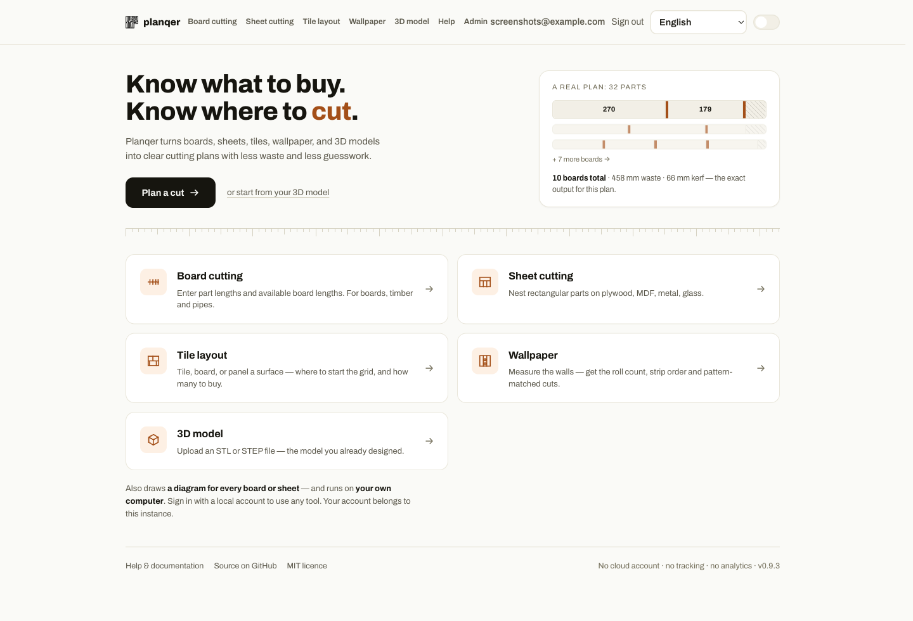
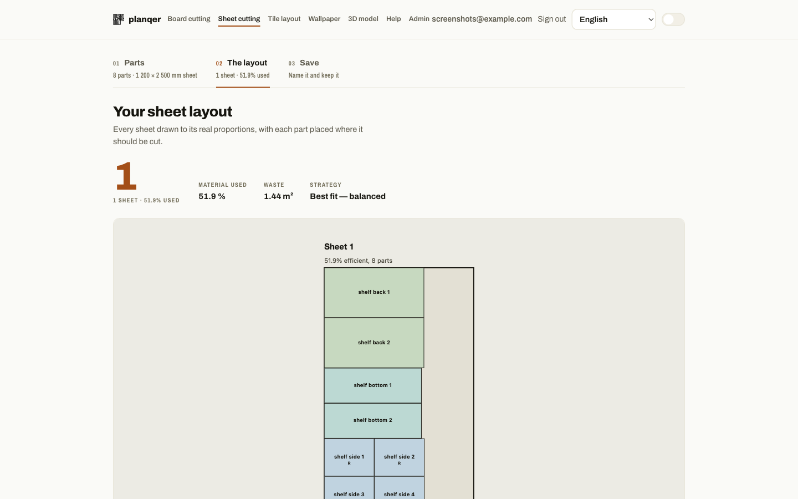
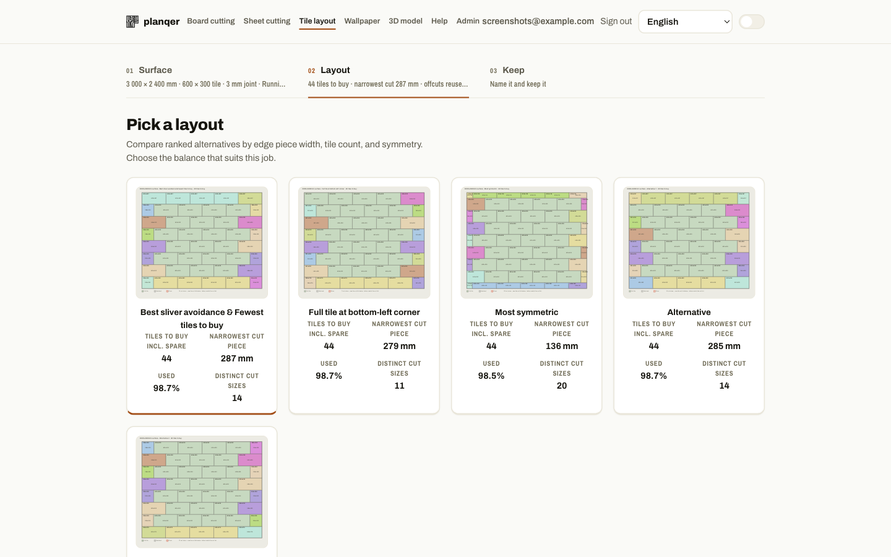
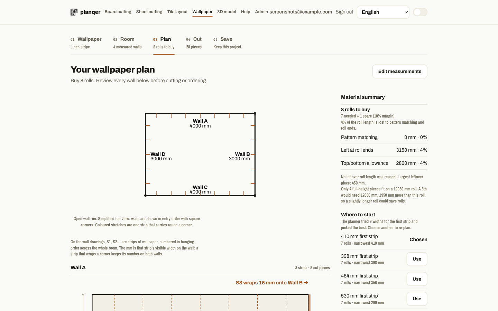
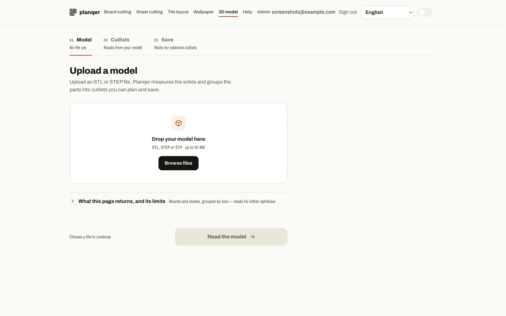
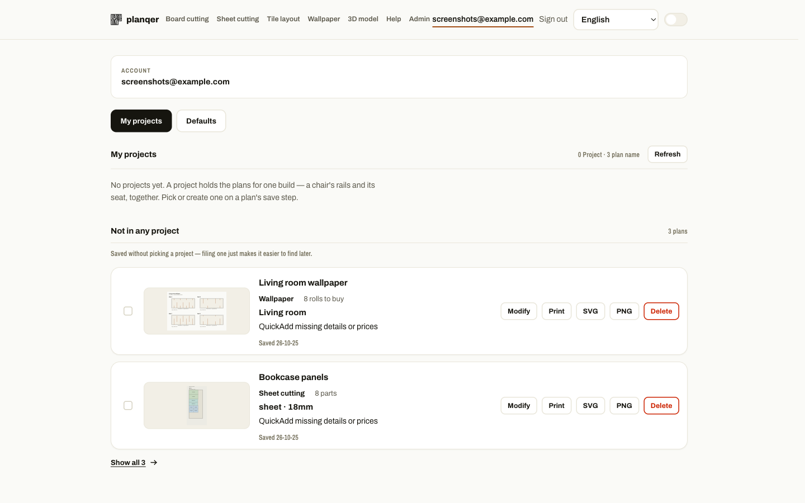

# Planqer

Planqer is a self-hosted cutting optimization platform for woodworking and
fabrication projects. It turns part lists or CAD files (STL/STEP) into
practical, kerf-aware cutting plans with visual diagrams and local project
storage.

[](https://nordstad.github.io/Planqer/app/)
[](LICENSE)
[](https://github.com/nordstad/Planqer/releases)
[](https://nordstad.github.io/Planqer/getting-started/)

---

> **Early development:** Planqer is still in beta and the product, APIs and
> behaviour may change between releases. If you find a bug, have an improvement
> or want to share feedback, please
> [open an issue](https://github.com/nordstad/Planqer/issues/new/choose).
> Pull requests for code and documentation improvements are welcome too.

## Features

- **Board, Sheet, Tile & Wallpaper Layouts**: Kerf-aware board and sheet cutting,
  tile grids that account for joints, openings, bond patterns, edge cuts, and
  waste, and repeat-aware wallpaper room plans with roll counts and cut sheets.
- **CAD File Support**: Upload STL or STEP files to automatically generate
  cutlists.
- **Norway & Sweden**: The built-in product catalogue covers Norway and
  Sweden, and the interface is available in English, Norwegian and Swedish.
  Need another country or language? [Open an issue](https://github.com/nordstad/Planqer/issues/new/choose).
- **Self-Hosted & Private**: Local accounts and data stay entirely on your
  server. Self-hosted Planqer contains no analytics. Only the public demo and
  docs site use anonymous, cookie-free usage counting; see the
  [privacy page](https://nordstad.github.io/Planqer/privacy/).
- **AI Assistant Integration**: Includes an MCP (Model Context Protocol) server
  for any MCP-compatible AI assistant or agent.

---



<!-- markdownlint-disable MD013 MD033 -->
<table>
<tr>
<td width="16%"><a href="docs/assets/screenshots/board-cutting-result.png"></a><br><sub>Board cutting</sub></td>
<td width="16%"><a href="docs/assets/screenshots/sheet-cutting-result.png"></a><br><sub>Sheet cutting</sub></td>
<td width="16%"><a href="docs/assets/screenshots/tile-layout.png"></a><br><sub>Tile layout</sub></td>
<td width="16%"><a href="docs/assets/screenshots/wallpaper-plan.png"></a><br><sub>Wallpaper</sub></td>
<td width="16%"><a href="docs/assets/screenshots/model-cutlist.png"></a><br><sub>3D model → cutlist</sub></td>
<td width="16%"><a href="docs/assets/screenshots/dashboard.png"></a><br><sub>Saved projects</sub></td>
</tr>
</table>
<!-- markdownlint-enable MD013 MD033 -->

Tile layout has its own guide with supported bond patterns, openings, edge-cut
controls, candidate ranking, and the REST API example:
[Tile layout documentation](docs/guide/tile-layout.md).

Wallpaper planning turns measured walls into a roll count, strip order and
pattern-matched cuts: [Wallpaper documentation](docs/guide/wallpaper.md).

---

## Try it in your browser

**[Open the Planqer demo](https://nordstad.github.io/Planqer/app/)** to try it
with nothing to install and no account. It is the light version: it runs
entirely in your browser, saves projects only in that browser, and has no
accounts, REST API or MCP server. See
[demo or full version](https://nordstad.github.io/Planqer/demo-vs-full/).
Running your own server (below) is the full version.

## Quick Start

Planqer runs with Docker Compose. The recommended route pulls the published
release images, so there is nothing to build. Just want a look first? Use the
[browser demo](https://nordstad.github.io/Planqer/app/) above, with nothing to
install.

**Before you start:** install [Docker Desktop](https://docs.docker.com/get-docker/)
(or Docker Engine with the Compose plugin on Linux), start it, and check it
works in a terminal:

```bash
docker compose version
```

**Which install?** If it is just you on one computer, pick Simple. If several
people or other devices need to use it, pick Advanced. Both keep projects in the
same data volume, so you can switch later.

### Simple install (recommended)

One person, one computer. No accounts or password, nothing to configure.

1. Make a folder for Planqer and download the compose file into it. Use the same
   folder every time: Docker names the data volume after it.

   macOS or Linux:

   ```bash
   mkdir planqer && cd planqer
   curl -O https://raw.githubusercontent.com/nordstad/Planqer/main/docker-compose.simple.yml
   ```

   Windows PowerShell (use `curl.exe`; plain `curl` is a different command
   there):

   ```powershell
   mkdir planqer; cd planqer
   curl.exe -O https://raw.githubusercontent.com/nordstad/Planqer/main/docker-compose.simple.yml
   ```

   No terminal download? Open [`docker-compose.simple.yml`](docker-compose.simple.yml)
   on GitHub, use **Download raw file**, and save it in a new `planqer` folder.

2. Start it from that folder. The first start downloads the images and can take
   a minute or two:

   ```bash
   docker compose -f docker-compose.simple.yml up -d
   ```

3. Check that both containers are running, then open <http://localhost:3001>.
   It is reachable only from that computer.

   ```bash
   docker compose -f docker-compose.simple.yml ps
   ```

> The simple install needs a release newer than 0.9.3. Until it is published,
> use the advanced install.

To stop Planqer, or to upgrade, run these in the same folder. Your projects stay
in the data volume:

```bash
# stop (projects are kept)
docker compose -f docker-compose.simple.yml down

# upgrade to the latest release
docker compose -f docker-compose.simple.yml pull
docker compose -f docker-compose.simple.yml up -d
```

### Advanced install

Several people or devices, with local accounts, an admin page, the REST API and
an optional MCP server.

1. Download the release compose file into a `planqer` folder, as above, but use
   `docker-compose.release.yml`.

   macOS or Linux:

   ```bash
   mkdir planqer && cd planqer
   curl -O https://raw.githubusercontent.com/nordstad/Planqer/main/docker-compose.release.yml
   ```

   Windows PowerShell:

   ```powershell
   mkdir planqer; cd planqer
   curl.exe -O https://raw.githubusercontent.com/nordstad/Planqer/main/docker-compose.release.yml
   ```

2. Start it and check it:

   ```bash
   docker compose -f docker-compose.release.yml up -d
   docker compose -f docker-compose.release.yml ps
   ```

3. Open the app on the same computer and create the first account. It becomes
   the administrator.

   - Frontend: <http://localhost:3001>
   - Backend API docs: <http://localhost:8002/docs>
   - Health check: <http://localhost:8002/health>

#### Using other devices or a hostname

By default Planqer answers only on the computer it runs on. To reach it from
other devices (for example `http://192.168.1.50:3001`) create a file named
`.env` in the same folder, with these lines changed to your address:

```dotenv
PLANQER_BIND_ADDRESS=0.0.0.0
PLANQER_TRUSTED_BOOTSTRAP=false
PLANQER_SETUP_SECRET=<a random secret, e.g. from: openssl rand -hex 32>
PLANQER_CORS_ORIGINS=http://192.168.1.50:3001
```

Then recreate the containers. Creating the first account now asks for the setup
code; enter the secret from `.env`, and remove it afterwards. Without
`PLANQER_CORS_ORIGINS`, sign-in fails silently as a blocked request.

```bash
docker compose -f docker-compose.release.yml up -d
```

Behind a reverse proxy or a real hostname, also set `PLANQER_HOST`. A ready-made
template with every option is [`.env.example`](.env.example); see
[Configuration](docs/reference/configuration.md) for what each variable does.

#### Upgrading

Back up first, then pull and recreate in the same folder. To pin a version, set
`PLANQER_VERSION` in `.env` (for example `PLANQER_VERSION=0.9.3`):

```bash
docker compose -f docker-compose.release.yml exec backend planqer backup
docker compose -f docker-compose.release.yml pull
docker compose -f docker-compose.release.yml up -d
```

The compose volume keeps local accounts and saved projects across upgrades.
Stop Planqer with `docker compose -f docker-compose.release.yml down`; add `-v`
only if you want to delete the data too.

### Build from source

Use `docker-compose.yml` to build the images yourself:

```bash
git clone https://github.com/nordstad/Planqer.git
cd Planqer
docker compose up -d --build
```

---

## Secret Scanning

Planqer uses [Betterleaks](https://github.com/betterleaks/betterleaks) to check
staged changes for accidentally committed secrets.

Install the pre-commit tool and enable the repository hook:

```bash
python -m pip install pre-commit
pre-commit install
```

The hook runs automatically before each commit. To run it manually:

```bash
pre-commit run betterleaks
pre-commit run betterleaks --all-files
```

The hook is installed per clone and is not enabled by `git clone` automatically.
Do not use `git commit --no-verify`, which bypasses the check.

---

## Documentation

Detailed guides, configuration options, API references, and MCP server setup
instructions are available in the documentation site.

📖 **[Read the Documentation](https://nordstad.github.io/Planqer/)**

> To preview the docs locally:
>
> ```bash
> pip install -r docs/requirements.txt
> mkdocs serve
> ```

---

## License

[MIT](LICENSE)

[](https://ko-fi.com/nordstad)
