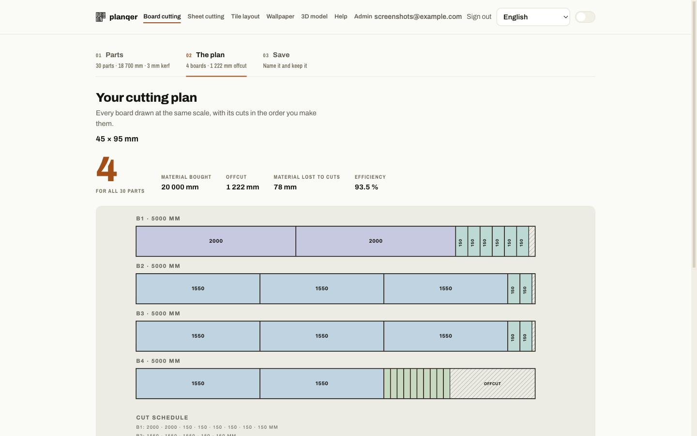

# Getting started

Planqer is officially supported via Docker Compose. The recommended install
uses published release images from GitHub Container Registry, so Docker does
not need to build the frontend, backend, or MCP server locally. Running from
source is a contributor path — see [Contributing](contributing.md) if that's
what you want.

## Two ways to use Planqer

**Try it in your browser (light version).** Open the
[Planqer demo](https://nordstad.github.io/Planqer/app/). Nothing to install and
no account. It runs in your browser, so projects are saved only in that browser
on that device, and clearing browser data deletes them. Export a backup to keep
them. Planqer is built for computers, where there is more room to work. It
also runs on phones: tested on a recent iPhone, other phones are untested. See
[Demo or full version](demo-vs-full.md) for what is different.

**Run your own server (full version, recommended).** Your projects are kept
on your own computer or server, with two ways to install it:

- **Simple install (recommended).** For one person on one computer, such as a
  workshop or a DIY project. No accounts, no password, nothing to configure:
  start it and use it. It can only be reached from the computer it runs on.
- **Advanced install.** For several people, other devices on your network, a
  reverse proxy or a real hostname. It has local accounts, an admin page, the
  REST API with rate limiting, and the optional MCP server for AI assistants.

Both run the same calculations and keep projects in the same data volume, so
you can start simple and switch later without losing anything. The rest of this
page covers both.

## Prerequisites

- [Docker](https://docs.docker.com/get-docker/)
- [Docker Compose](https://docs.docker.com/compose/install/) (bundled with
  Docker Desktop)

## Simple install (recommended)

```bash
curl -O https://raw.githubusercontent.com/nordstad/Planqer/main/docker-compose.simple.yml
docker compose -f docker-compose.simple.yml up -d
```

Open <http://localhost:3001> and start planning. There is no sign-in: whoever
opens the app on this computer is its owner. Saved plans are under **My
projects**, and the catalogue is under **Catalogue**.

!!! note "Only this computer"
    The simple install is reachable only from the computer it runs on. That is
    what makes it safe to run without a password. If you open it to your
    network, anyone on that network can read and change your projects. Planqer
    refuses to start without sign-in on a network address unless you set
    `PLANQER_ALLOW_OPEN_LAN=true`. If you want other devices, use the advanced
    install instead.

To upgrade, back up first, then pull and recreate. See [Upgrade](#upgrade) and
use `docker-compose.simple.yml` in place of `docker-compose.release.yml`.

## Advanced install

```bash
git clone https://github.com/nordstad/Planqer.git
cd Planqer
docker compose -f docker-compose.release.yml up -d
```

Open:

- Frontend: <http://localhost:3001>
- Backend API docs (Swagger UI): <http://localhost:8002/docs>
- Health check: <http://localhost:8002/health>

!!! note "First account is the admin"
    The default Compose files bind Planqer only to `127.0.0.1`. Open the app on
    the same computer and create the first account in the browser; it becomes
    the instance administrator. Every account is **local to that instance** —
    there is no cloud tier, and accounts never leave your own server.

!!! warning "LAN and reverse-proxy deployments"
    Before exposing a fresh instance, set `PLANQER_BIND_ADDRESS=0.0.0.0`,
    `PLANQER_TRUSTED_BOOTSTRAP=false`, and a random `PLANQER_SETUP_SECRET` in
    `.env`. The first-run form has a **Setup code** field: enter that secret
    there to create the first administrator. Remove the secret after setup.

!!! note "Backups"
    Saved projects and local accounts live in the backend data volume. Create
    a live-safe backup with
    `docker compose -f docker-compose.release.yml exec backend planqer backup`;
    see [Backup and restore](guide/backup-and-restore.md) before restoring one.

!!! note "Release image version"
    The release compose file uses `latest` by default. Set
    `PLANQER_VERSION` in `.env` to pin a specific release image.

## Upgrade

Run these commands from the directory containing `docker-compose.release.yml`
(or `docker-compose.simple.yml` for the simple install) and `.env`:

```bash
# Back up accounts and saved projects before upgrading.
docker compose -f docker-compose.release.yml exec backend planqer backup
docker compose -f docker-compose.release.yml pull
docker compose -f docker-compose.release.yml up -d
```

To pin a release, set the version in `.env` before running the commands:

```dotenv
PLANQER_VERSION=0.11.0
```

Verify that the running containers use the requested images:

```bash
docker compose -f docker-compose.release.yml ps
docker inspect planqer-web-backend --format '{{.Config.Image}}'
```

The output should include `ghcr.io/nordstad/planqer-backend:0.11.0` (and the
corresponding frontend tag). The named `backend_data` volume is preserved by
this procedure, so local accounts and saved projects remain available. Keep
using the same directory and Compose project name for future upgrades: Docker
names the volume `<project>_backend_data`. Changing either can make Compose
start against a different, empty database. Confirm the volume before an
upgrade with:

```bash
docker compose -f docker-compose.release.yml config --volumes
docker volume inspect planqer_backend_data
```

After an upgrade, verify that expected accounts are still present:

```bash
docker compose -f docker-compose.release.yml exec backend \
  python create_admin.py list
```

## Private package access

GitHub Container Registry packages can be private. If `docker compose` cannot
pull the images anonymously, either make the Planqer packages public in GitHub
Packages or log in before starting the stack:

```bash
echo <github-token> | docker login ghcr.io -u <github-username> --password-stdin
```

## Build from source

Use the source-build compose file when contributing or testing local code
changes:

```bash
docker compose up -d --build
```

The MCP server is optional and is not built or started by default. Enable it
when you need a containerized MCP client:

```bash
docker compose --profile mcp up -d --build
```

For the published images, use the same profile with the release Compose file:

```bash
docker compose -f docker-compose.release.yml --profile mcp up -d
```

## Plan your first cut

1. Open <http://localhost:3001> and choose **Board cutting**, **Sheet cutting**,
   **Tile layout**, **Wallpaper**, or **3D model**.
2. Advanced install only: sign in or create a local account when prompted. The
   optimizer pages, model uploads, and saving a plan require a local account.
   The simple install has no sign-in.
3. Enter your parts, surface and tile dimensions, wall measurements, or upload
   a model. Add stock lengths, sheet size, openings, or tile layout options as
   appropriate.
4. Run the plan and read the boards/sheets-required figure.
5. Download the diagram, or name and save the plan to your dashboard.



## Configuration for a real deployment

Running on `localhost` needs no configuration. If you're putting Planqer
behind a reverse proxy or a real hostname, see
[Configuration](reference/configuration.md) — in particular `PLANQER_HOST`,
which the frontend's dev server requires or it will refuse requests with a
"Blocked request" error.

## Next steps

- [Board cutting](guide/board-cutting.md) — 1D parts from boards, lumber, pipe.
- [Sheet cutting](guide/sheet-cutting.md) — 2D parts nested on sheet stock.
- [Tile layout](guide/tile-layout.md) — rectangular tile patterns on a surface.
- [Wallpaper planning](guide/wallpaper.md) — repeat-aware room plans and cut order.
- [3D model / STEP cutlists](guide/model-cutlist.md) — start from a model
  instead of typing a part list.
- [Backup and restore](guide/backup-and-restore.md) — protect saved projects
  and local accounts.
- [MCP server](guide/mcp-server.md) — drive the optimizer from an AI assistant.
