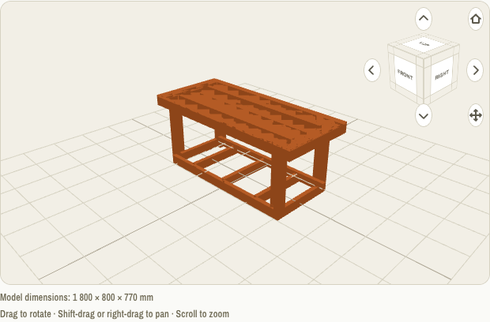
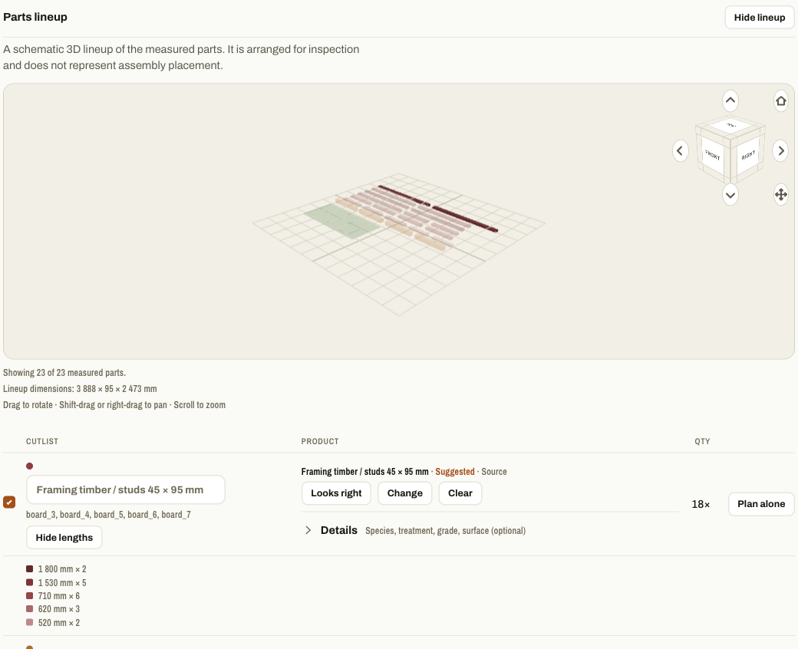
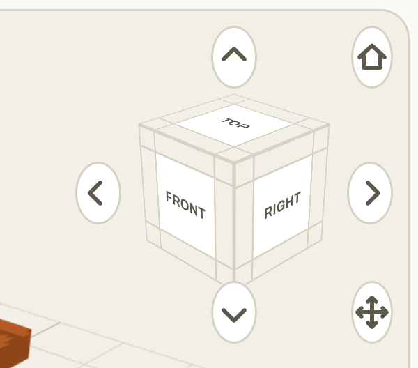

# 3D model / STEP cutlists

Start from the model you already designed instead of typing a part list.
Route: `/model-cutlist`.

## Supported files

| Format | What you get |
| --- | --- |
| **STL** | Every solid in the file, split out and measured. |
| **STEP / STP** | The same, plus real component names, materials, and assembly hierarchy — because STEP carries that metadata and STL doesn't. |

Files up to 50 MB. Planqer works in millimetres; the file's own declared unit
is used if it has one.

!!! tip "No model to hand? Try the demo bench"
    The project ships a small demo model, a 1 800 × 800 × 770 mm workbench, so
    you can try this page without a CAD file of your own. Find both files in the
    [`example/` folder](https://github.com/nordstad/Planqer/tree/main/example)
    of the repository, or in `example/` if you have cloned it.

    - **`bench.stl`** shows the STL path: a preview in the browser, then 23
      parts grouped into 3 cutlists (two board sizes and one sheet).
    - **`Bench.step`** is the same bench as a STEP file, so you can compare. It
      gives the same 23 parts and 3 cutlists, and keeps the real component names
      from the CAD model, such as *Top Studs*, *Front Left Leg* and *Top Ply*.

    Drop one on the page and press **Read the model**.

## Workflow

1. Drop or browse to your file and click **Read the model**.
2. Planqer measures every solid, classifies each as a board-shaped or
   sheet-shaped part, and groups them into cutlists by size.
3. Review the cutlists. For each one you can rename it, choose a product
   (or leave it empty), and expand the list of lengths or sizes it contains.
   Untick any you don't want. Planqer matches each measured cross-section to the
   catalogue (within 1 mm) and pre-selects the common match, marked
   **Suggested** until you press **Looks right** or change it. A product you
   choose is remembered for that cross-section next time.

   A STEP file's own material names are read the same way. Names such as
   `C24`, `Furu`, `OSB/3` or `Birch plywood` are looked up among the catalogue's
   type names and aliases, species, treatments, profiles and grades, in any of
   Planqer's languages and regardless of case or spacing, so equivalent names
   (`C24`, `c24`) end up in one cutlist rather than two. When the name says what
   the product is (a type or a grade), exactly one product type fits it at the
   measured size, and nothing in it is ambiguous, the product is selected and
   marked **From model**. Anything weaker, such as a species alone or a size
   the type doesn't come in, is still offered but marked **Suggested**, and a
   name the catalogue doesn't know stays your own words. Either way you can
   review and change it.
4. Either hand one cutlist off on its own with **Plan alone** — the parts and
   the chosen product arrive pre-filled on the [board](board-cutting.md) or
   [sheet](sheet-cutting.md) page — or plan the selected cutlists together.
5. On the save step every cutlist has its own stock lengths (or sheet size) —
   the chosen product can offer its standard lengths or sheet sizes —
   cut width and optional prices. **Apply to all board groups** and **Apply to
   all sheet groups** copy one cutlist's stock, cut width and prices to the
   others. Prices are never required: without them a cutlist is planned for
   the least waste; with a price on every length (or the sheet) the saved
   plan carries its cost.
6. Save. By default every cutlist goes into a new project named after the model
   file (rename it in place), made when you save. If you already have a project
   with that name it is picked instead, so importing the same model again keeps
   its plans together. You can also choose another project, or none. A link
   takes you straight to that project.

!!! note "Uploading doesn't need an account"
    Reading and extracting a model works without signing in. Planning and
    saving the resulting cutlist does.

## Previewing the model

### STL preview

When you choose an STL file, Planqer can show an interactive browser preview
before reading the model. Rotate, zoom, or pan the model to check that the
correct file is selected. The preview is read from the selected file in your
browser; it is not uploaded separately and is not saved with a project.

Very large or highly detailed files may skip the browser preview to keep the
page responsive. This does not change the 50 MB model-upload limit or prevent
you from pressing **Read the model**. If the browser cannot provide a 3D
context, the cutlist workflow remains available without the preview.

STEP and STP files do not have a geometry preview before reading. Once the
model has been read, both formats get the parts lineup below.

### Parts lineup

After the model has been read, the cutlists step shows a schematic 3D lineup of
the measured parts. Each cutlist has its own colour, shown as a dot beside its
row. Within a cutlist, every distinct length gets its own shade of that colour,
longest darkest, so identical parts match and different lengths are easy to
tell apart.

- Point at, or tab to, a cutlist row to highlight its parts. The others fade.
- Open **Show lengths** on a cutlist to see a swatch beside each length. Point
  at a length to highlight just those parts in the lineup.
- Untick a cutlist and its parts fade out of the lineup.
- Every part is drawn, up to 500. Beyond that, repeated parts are combined into
  one box per size, and the page says so.
- **Hide lineup** collapses the panel.

The lineup is arranged for inspection. Parts are laid out in rows by cutlist, so
it does not preserve assembly placement or reconstruct the assembled CAD model
in the browser.

### Navigating the view

Both previews can be turned with the mouse: drag to rotate, scroll to zoom, and
Shift-drag or right-drag to pan. On a touch screen, one finger rotates and two
fingers pan and zoom. A hint under the preview reminds you of this. A
navigation cube in the top-right corner shows which way the model is turned and
gives you quicker ways to move it:

{width=300}

- Click a **face** of the cube to look from the front, back, left, right, top or
  bottom. Click an **edge** or **corner** to look from between two or three
  faces. The view flies there instead of jumping.
- The **arrows** turn the model a quarter turn in the direction they point, the
  same way as dragging it.
- The **pan** button (four arrows) makes a plain drag move the model instead of
  turning it, which helps on a trackpad where right-drag is awkward. Press it
  again to go back to rotating.
- The **house** returns to the starting angle, zoom and position, undoing any
  panning.

The cube keeps its light colours in dark mode, because the 3D view behind it is
light in both themes.

From a face-on view, the neighbouring faces are edge-on and cannot be clicked.
Use the cube's edges, the arrows, or the house to move on.

STL files are treated as Z-up, as CAD programs export them, so the front, top
and side views match your CAD program. The size under the preview is X × Y × Z
as stored in the file.

## Limits

- Up to 50 MB per file.
- Splitting relies on the model being composed of separate solids/bodies —
  a single fused solid won't be split into its logical parts.
