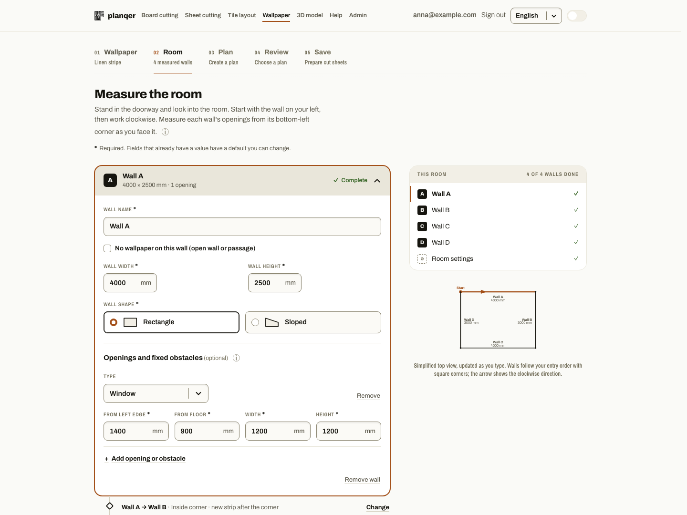
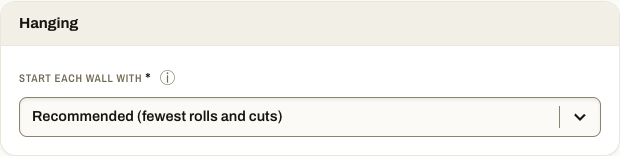
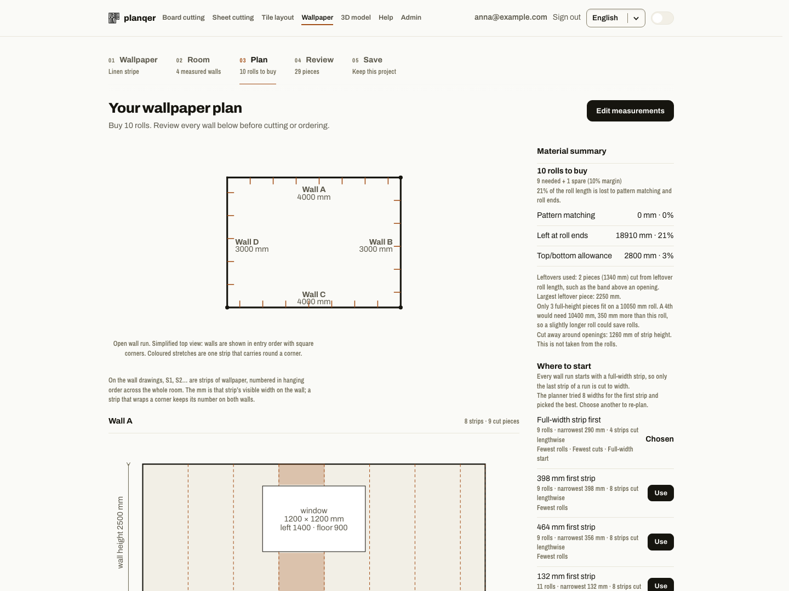
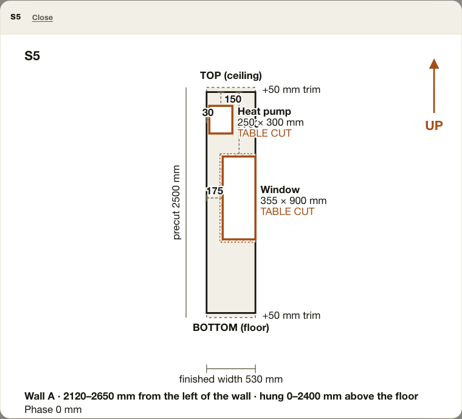

# Wallpaper planning

The wallpaper planner turns measured elevations into a roll count, a pattern-aware
cut order and a hanging checklist. It is a measurement aid, not manufacturer
installation guidance.

## Measure the room

Stand in the doorway and look into the room. Start with the wall on your left
and work clockwise, one wall at a time. Walls are lettered like a drawing
(Wall A, B, C…); rename them by what is on them, such as "Window wall". A live
top view of the room beside the form updates as you type, marks the start and
highlights the wall you are editing. Use the **bottom-left corner** as the
origin for every wall: record widths at the top, middle and bottom, then the left,
middle and right heights. Include the finished casing where paper will meet it.

Add doors, windows and fixed obstacles by their left and bottom offsets and
their bounding rectangle. For a heat pump or radiator, choose the fixed-obstacle
option so the plan can split the strip above and below it and leave the selected
tuck allowance. Confirm the elevation before planning.

If a wall needs no paper, such as an open passage, tick **No wallpaper on this
wall**. Enter only its width so the room still closes; it is drawn dashed on the
top view and no strips are planned for it.

## Pattern and allowances

Plain wallpaper has a repeat of zero. For patterned wallpaper, enter the repeat
printed on the roll and choose straight or half-drop matching. Planqer reports a
phase for each cut, but always visually match the motif to the previous strip
before cutting.

The plan adds top, bottom, opening and corner allowances. They are deliberate
extra material for final trimming, not finished dimensions. The top and bottom
allowances are included in each piece's cut length (only at the ceiling and floor
ends) and the pattern phase is worked out for the top of the paper. Keep all bought
rolls from the same batch/run.

## Corners

Choose a treatment for every corner before planning. Inside corners default to
a **15 mm overlap**: the final strip on a wall wraps 15 mm round the corner and
the next wall starts a fresh strip over it, which keeps the corner crisp even
when the wall is not plumb. The overlap is the corner allowance, so it can be
changed in the **Corner overlap (mm)** field above the corners (0–50 mm, for
example 10–20 mm for a corner that is not plumb). The cut sheet lists it as
extra width on that strip.

The other choices are a butt joint (a fresh strip with no overlap) and carrying
the final strip's leftover width round the corner. Outside corners always wrap.
If the final strip already uses the full roll width there is no room to wrap,
so the planner prefers a layout that leaves room.

## Where the first strip goes

Paper is hung in strips of one roll width, so every wall ends with a piece
that is narrower than a roll. Where that cut strip goes decides how many strips
you cut lengthwise, how many rolls you buy and whether you are left with a
sliver that is hard to hang. Set it with **Start each wall with** in the
**Hanging** card on the Wallpaper step.

### Recommended

This is the default. For every wall run Planqer tries the first-strip widths in
5 mm steps and picks the layout that is best by these rules, in order:

1. **Safe to hang.** No seam on an outside corner, no strip narrower than
   50 mm, and no cut strip or corner piece narrower than 100 mm. A layout that
   fails is used only when nothing else works.
2. **Fewest rolls to buy.** This is the cost.
3. **Fewest strips cut lengthwise.**
4. **Widest narrowest piece**, then the least waste.

A strip that starts at the wall's left edge at full roll width leaves only the
last strip of the wall to cut. So when it is safe and costs no extra roll, the
recommended start is a **full-width first strip**, and the cut strip is the last
one hung on the wall.

| Wall width | Recommended start | Cut strips | Rolls (2400 mm walls) |
| --- | --- | --- | --- |
| 3000 mm | Full strip, then a 350 mm last strip | 1 | 2 |
| 4400 mm | Full strip, then a 160 mm last strip | 1 | 3 |
| 3180 mm | Six full strips, nothing to cut | 0 | 2 |
| 5850 mm | 275 mm first and last strips | 2 | 3 |

The 5850 mm wall cannot start with a full strip: eleven full strips leave
only 20 mm, which is too narrow to hang. Planqer balances the first and last
strips instead, for that wall only. Every wall run is decided separately, so
one awkward wall does not take the others away from a full-width start.

### Even pieces at both ends

This makes the pieces at the two ends of a wall run as even as possible. On a
single wall the first and last strips are equally wide, so the layout is
symmetrical. Choose it when you want that look. It is also how plans saved
before this setting existed were laid out, so Planqer reopens them with this
choice and their result does not change. To re-plan an old plan,
change the setting to **Recommended** and press **Create plan**.

### What the Plan step tells you

The **Where to start** section of the Plan step says how the start was chosen:

- how many wall runs start with a full-width strip;
- for each wall that does not, why: a full-width start would leave a piece under
  100 mm, or another start needs less wallpaper;
- how many more rolls starting every wall run with a full-width strip would need,
  when that is more;
- how many fewer rolls another start would need, when you forced a first-strip
  width that costs more.

Below that are the starts that were tried, best first. Each shows its roll
count, its narrowest piece and how many strips are cut lengthwise. Starts that
are safe to hang are tagged **Fewest rolls**, **Fewest cuts** and
**Full-width start** where they earn it. **Use** re-plans with that first-strip
width on every wall run and overrides the setting until you press **Create
plan** again or change the setting. A start with a seam problem is marked
**needs attention**.

## Rooms with steps, alcoves and partitions

Any room made of straight, square-cornered walls can be planned, not only a
box. Treat every wall face that carries paper as one wall, in the order you meet
it walking clockwise, and describe each corner as you reach it:

- **Inside corner**: the wall turns towards you, so the room closes in. The
  walls of a plain box are all inside corners.
- **Outside corner**: the wall turns away from you, such as the end of a
  partition or a chimney breast. A strip always wraps an outside corner, and
  Planqer never puts a seam on the edge itself.

A free-standing partition is three walls: the face on one side, its short end
and the face on the other side, joined by two outside corners. The end is a wall
in its own right, even if it is only 600 mm wide, and it can carry openings.

| Wall | Width | Corner to the next wall |
| --- | --- | --- |
| A East | 2650 mm | Inside |
| B South | 5400 mm | Inside |
| C West | 2650 mm | Inside |
| D Partition, first face | 4350 mm | Outside |
| E Partition, end | 600 mm | Outside |
| F Partition, second face | 4350 mm | None: start a new wall run |
| G Top wall | 4250 mm | |

Use **No corner: start a new wall run** where two papered areas do not touch,
such as a separate alcove. No strip is carried across, and the top view draws
the runs apart. Leave **Walls form a closed room** unticked unless the last wall
really meets the first. When it is ticked Planqer checks that the walls close to
within 10 mm, and warns by how much they do not.

Check the top view before planning. It follows your entry order with square
corners, so a wall that runs the wrong way or a corner marked inside instead of
outside shows up as a shape that does not match the room.

## Read the cut plan

The Plan step shows the rolls needed, the spare rolls added by your spare margin
and the roll length lost to pattern matching, roll ends and top/bottom allowance.
The spare margin starts from the default on your Defaults tab and can be changed
on the Wallpaper step.

Pattern loss is net of reuse. A short piece, such as the band above a heat pump,
is cut from leftover roll length when it fits, and a pattern gap that a later
piece fills counts as reused, not lost. The summary lists both and names the
largest leftover piece. When a slightly longer roll would fit one more
full-height piece on every roll, it says how much longer.

Enter an optional price per roll on the Wallpaper step to see an estimated cost
on the Plan step, the Save step and the saved project card. The cost uses the
currency and VAT basis from your Defaults tab.

The planner tries several widths for the first strip and picks the best one
according to your **Start each wall with** setting (see
[Where the first strip goes](#where-the-first-strip-goes)). Strips are labelled
S1, S2 and so on in hanging order across the whole room, and a wall marked as
having no wallpaper is shown as such and uses no material. Use Modify on a saved
wallpaper plan to reopen it with its start setting, start choice, margin and
prices.

The **Review** step gives you the finished cut plan before you save it. Its
summary, room overview and wall picker lead into one wall at a time: the wall
elevation, strip table and special-piece drawings. Choose a wall from the
picker or directly in the room overview. Each piece is named on the wall
drawing and says where it hangs, so the table and drawing are easy to match.

Each drawing shows:

- **Up and down.** An arrow marks up, and the top and bottom edges are named,
  with the ceiling and floor ends shaded as the trim allowance.
- **Openings.** Each opening has its name, size and a hatched margin around it.
  A solid outline is a table cut; a dashed outline is an outlet or switch to
  mark on the wall and trim in place.
- **Measurements.** The numbers are millimetres from the piece's top edge and
  left edge to each opening, as you measure at the cutting table.

The drawings are a guide, not exact: walls are rarely square, so trim to the
real opening in place. They are also kept when you reopen a saved plan with
Modify, and Print adds them, several to a page and grouped by wall, after the
overview. Plans saved before this feature show openings as plain rectangles
until you plan them again.

### Open a saved plan

From a project's dashboard page, select **Open plan** on a wallpaper plan to
read the same document later on any screen. Use **Print** for a paper copy, or
**Modify** (also in the **More actions** menu) to change the saved inputs.
The plan remains read-only until you choose Modify; saving the changed inputs
replaces its result.

For paste, trimming technique, electrical safety and product-specific handling,
follow the manufacturer guide saved with the wallpaper. Do not rely on Planqer
for those instructions.
