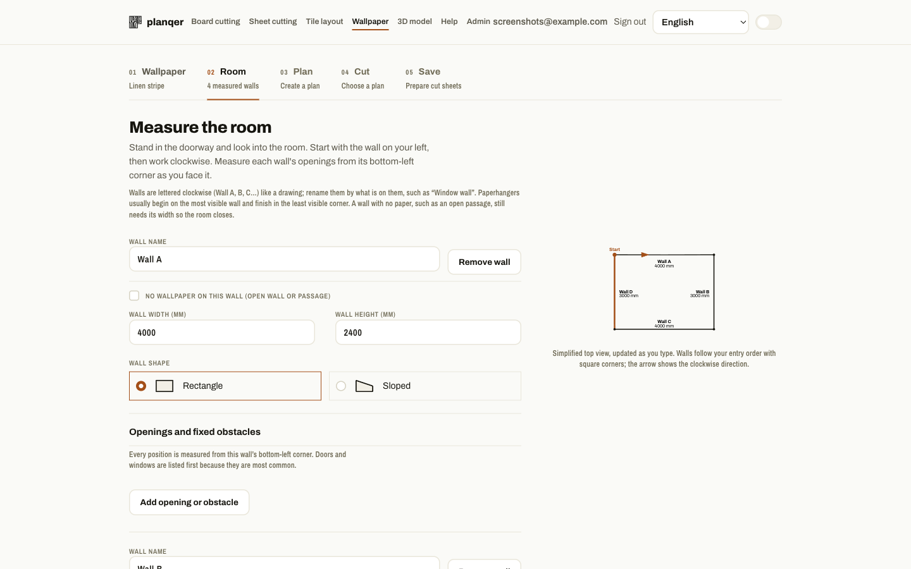
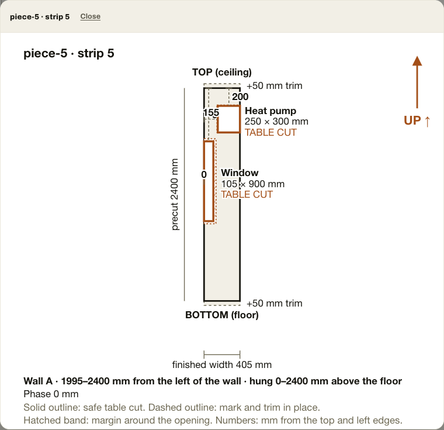

# Wallpaper planning

The wallpaper planner turns measured elevations into a roll count, a pattern-aware
cut order and a hanging checklist. It is a measurement aid, not manufacturer
installation guidance.

## Measure the room

Stand in the doorway and look into the room. Start with the wall on your left
and work clockwise, one wall at a time. Walls are lettered like a drawing
(Wall A, B, C…); rename them by what is on them, such as "Window wall". A live
top view of the room beside the form updates as you type, marks the start and
highlights the wall you are editing. Use the **bottom-left corner** as the
origin for every wall: record widths at the top, middle and bottom, then the left,
middle and right heights. Include the finished casing where paper will meet it.

Add doors, windows and fixed obstacles by their left and bottom offsets and
their bounding rectangle. For a heat pump or radiator, choose the fixed-obstacle
option so the plan can split the strip above and below it and leave the selected
tuck allowance. Confirm the elevation before planning.

If a wall needs no paper, such as an open passage, tick **No wallpaper on this
wall**. Enter only its width so the room still closes; it is drawn dashed on the
top view and no strips are planned for it.

## Pattern and allowances

Plain wallpaper has a repeat of zero. For patterned wallpaper, enter the repeat
printed on the roll and choose straight or half-drop matching. Planqer reports a
phase for each cut, but always visually match the motif to the previous strip
before cutting.

The plan adds top, bottom, opening and corner allowances. They are deliberate
extra material for final trimming, not finished dimensions. Keep all bought
rolls from the same batch/run.

## Corners

Choose a treatment for every corner before planning. Inside corners default to
a **15 mm overlap**: the final strip on a wall wraps 15 mm round the corner and
the next wall starts a fresh strip over it, which keeps the corner crisp even
when the wall is not plumb. The overlap is the corner allowance, so it can be
changed in the **Corner overlap (mm)** field above the corners (0–50 mm, for
example 10–20 mm for a corner that is not plumb). The cut sheet lists it as
extra width on that strip.

The other choices are a butt joint (a fresh strip with no overlap) and carrying
the final strip's leftover width round the corner. Outside corners always wrap.
If the final strip already uses the full roll width there is no room to wrap,
so the planner prefers a layout that leaves room.

## Read the cut plan

The Plan step shows the rolls needed, the spare rolls added by your spare margin
and the roll length lost to pattern matching, roll ends and top/bottom allowance.
The spare margin starts from the default on your Defaults tab and can be changed
on the Wallpaper step.

Pattern loss is net of reuse. A short piece, such as the band above a heat pump,
is cut from leftover roll length when it fits, and a pattern gap that a later
piece fills counts as reused, not lost. The summary lists both and names the
largest leftover piece. When a slightly longer roll would fit one more
full-height piece on every roll, it says how much longer.

Enter an optional price per roll on the Wallpaper step to see an estimated cost
on the Plan step, the Save step and the saved project card. The cost uses the
currency and VAT basis from your Defaults tab.

The planner tries several widths for the first strip and picks the best. The
"Where to start" list shows the alternatives with their roll counts; choose one
to re-plan. Strips are labelled S1, S2 and so on in hanging order across the
whole room, and a wall marked as having no wallpaper is shown as such and uses
no material. Use Modify on a saved wallpaper plan to reopen it with its start
choice, margin and prices.

The Cut step shows a drawing of every piece on the selected wall. Each piece is
named on the wall drawing (piece-1, piece-2…) and its drawing says where on the
wall it is hung, so the two are easy to match. Select a drawing to see it full
size.

Each drawing shows:

- **Up and down.** An arrow marks up, and the top and bottom edges are named,
  with the ceiling and floor ends shaded as the trim allowance.
- **Openings.** Each opening has its name, size and a hatched margin around it.
  A solid outline is a table cut; a dashed outline is an outlet or switch to
  mark on the wall and trim in place.
- **Measurements.** The numbers are millimetres from the piece's top edge and
  left edge to each opening, as you measure at the cutting table.

The drawings are a guide, not exact: walls are rarely square, so trim to the
real opening in place. They are also kept when you reopen a saved plan with
Modify, and Print adds them, several to a page and grouped by wall, after the
overview. Plans saved before this feature show openings as plain rectangles
until you plan them again.

The Cut step also lists
pieces in chronological roll order. Mark a piece cut only after table cutting;
then mark it hung once it is on the wall.

For paste, trimming technique, electrical safety and product-specific handling,
follow the manufacturer guide saved with the wallpaper. Do not rely on Planqer
for those instructions.
