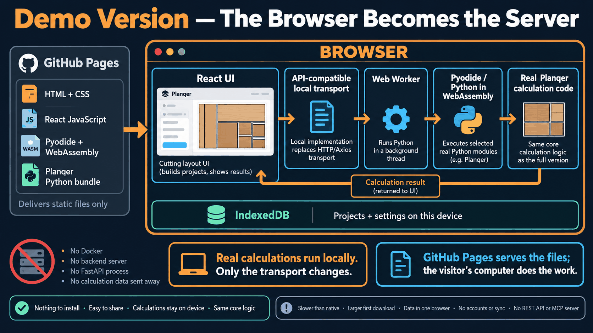
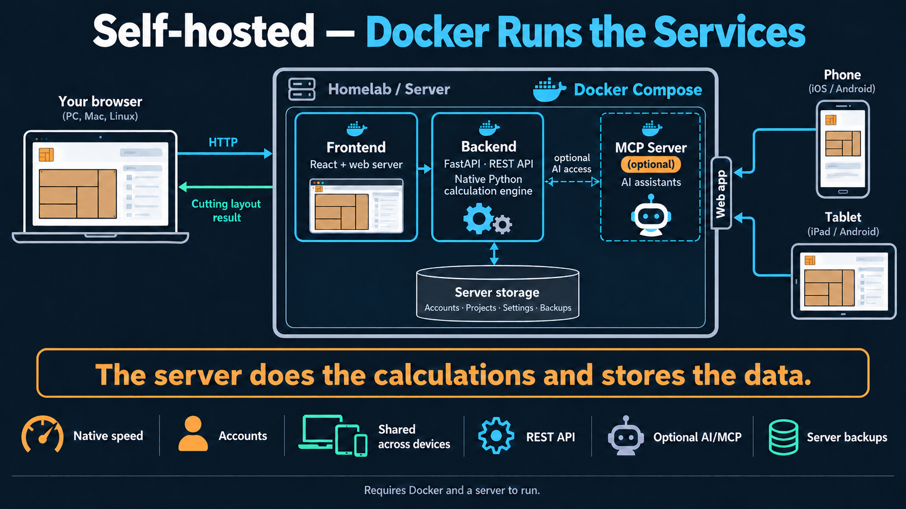

# Lite or self-hosted

Partsible comes in two forms. [Partsible Lite](https://partsible.com/)
runs in your browser with nothing to install. The self-hosted version is the Docker
Compose deployment on your own server (see [Getting started](getting-started.md)).
Both run the same calculation code, so the results are the same.

## Partsible Lite

Lite is a static site served by Cloudflare Pages. The browser loads the React
interface, Pyodide and the bundled Python code, then runs the calculation in a
Web Worker. Projects and settings stay in this browser's IndexedDB; no backend
server is involved.

## The self-hosted version

The self-hosted version runs as a Docker Compose stack on your own server. The browser
talks to the frontend and FastAPI backend over HTTP; the backend runs the native
Python calculation engine and stores accounts, projects, settings and backups.
The MCP server is optional.

## What is the same

Board, sheet, tile and wallpaper planning, cost analysis, SVG, PNG and print
output, catalogue search, and STEP and STL cutlists.

## What is different

<!-- markdownlint-disable MD013 -->

| Area | Lite (browser) | Self-hosted (Docker) |
| --- | --- | --- |
| Accounts, login and administration | Not available. One user, no sign-in | Local accounts on your server |
| Where projects are stored | Only in this browser on this device | On your server |
| Sync between devices | Not available. Export and import a backup file | Every device that reaches your server |
| Data loss risk | Clearing browser data deletes projects; Safari can clear unused storage after about seven days | Your server's own backups (`partsible backup`) |
| MCP server for AI assistants | Not available | Included |
| REST API and Swagger docs | Not available | Included |
| Custom catalogue entries | The Catalogue page, stored in this browser | Edited by the instance admin |
| Speed | About 2.5 times slower than native on a desktop; large diagonal tile layouts can take 10 to 20 seconds | Native speed |
| First load | A one-off download of about 6 MB, cached afterwards | Nothing to download |
| STL import | An extra one-off download of about 18.5 MB on first use, and it needs a lot of memory | No extra download |
| Phones | Computer first, with more room to work. Tested on a recent iPhone, where it works well; other phones are untested | Works in the phone browser, as it is a normal web app |
| Browsers | Current Chrome, Edge, Firefox and Safari (needs WebAssembly and web workers) | Any modern browser |
| Usage statistics | Anonymous and cookie-free, with an opt-out ([Privacy](privacy.md)) | None |

<!-- markdownlint-enable MD013 -->

## Moving between them

A Lite backup cannot be imported into a self-hosted server, because the two
store projects differently. To move over, open each saved project in Lite
and save it again on your server.

## Which should I use?

Use Lite to try Partsible or for a one-off plan. Use the self-hosted version if you
want your projects kept safely on a server, on more than one device, or if you
want the API or AI assistants.
