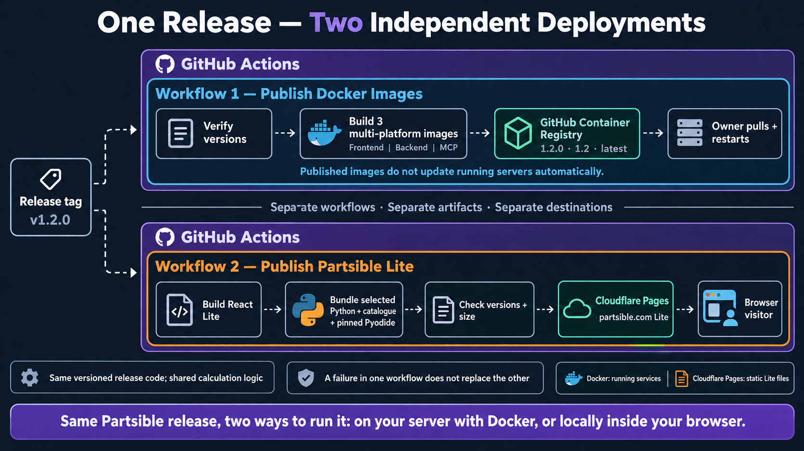

# Releasing

Partsible releases are published by pushing a semantic-version tag in the form
`vX.Y.Z`. The `Publish images` GitHub Actions workflow builds and publishes the
backend, frontend, and MCP server images to GHCR. The same tag also updates
Partsible Lite at `partsible.com`, built from that tag (see
[The Cloudflare sites](#the-cloudflare-sites)). The docs at
`docs.partsible.com` are published separately, when `docs/` changes on `main`.

## One release, two deployment paths

A release tag starts two independent GitHub Actions workflows. One publishes
versioned Docker images to GitHub Container Registry; the other builds
Partsible Lite and deploys it to Cloudflare Pages. Publishing images does not
update a running server automatically, and a failure in one workflow does not
replace the other deployment.



## Pre-release checks

Run all checks from a clean working tree before changing any version numbers.

### Backend

```bash
cd backend
uv sync --frozen
uv run ruff check .
uv run ruff format --check .
uv run pytest
```

The Ruff checks enforce linting and formatting. `pytest` is the backend unit
and API test suite.

### Frontend

```bash
cd frontend
npm ci
npm test
npm run build
```

### MCP server

```bash
cd mcp-server
npm ci
uv sync --frozen --group dev
npm run test:all
```

### Partsible Lite

```bash
python3 scripts/build-lite.py --check-budget
cd frontend
npx playwright install chromium firefox webkit   # once
npm run test:lite
npm run test:parity
npm run test:runtime-browser
npm run test:analytics
```

The first command builds Lite as Cloudflare Pages serves it and fails if a
runtime file is missing, the bundled Python is a different version from the
app, or Lite has grown past its size budget. `test:lite` runs it in three
browser engines. The `Static Lite CI` workflow runs the same checks on every
pull request that touches the app, the Python it runs, or the scripts.

If the size budget fails because of a change you meant to make, raise the
limit in `BUDGET_KB` in `scripts/build-lite.py` in the same pull request.

`test:analytics` builds the app with the Umami website id and checks, in
Chromium with the tracker stood in for, that only allow-listed events are sent
and nothing is sent after an opt-out or with Do Not Track. Run
`npm run test:runtime-browser` on a Mac before a release: Playwright's Linux
WebKit cannot load scipy, so CI leaves out the STL import there.

Do not continue with the release if any check fails.

## Version and tag

Update the release version consistently in:

- `backend/partsible/__init__.py`
- `backend/pyproject.toml`
- `backend/uv.lock`
- `frontend/package.json`
- `frontend/package-lock.json`
- `mcp-server/package.json`
- `mcp-server/package-lock.json`
- `mcp-server/pyproject.toml`
- `mcp-server/src/index.ts`
- `mcp-server/src/partsible_mcp_server/server.py`
- `mcp-server/uv.lock`

Lite shows the version from `frontend/package.json` in its footer, and the
Python it runs is stamped with `backend/partsible/__init__.py`.
`scripts/build-lite.py` fails if the two differ, so Lite cannot ship a
mismatched pair.

The same version is also written in the documentation's examples, which users
copy to pin a release. Update these too:

- `docs/getting-started.md` (`PARTSIBLE_VERSION` and the image tag)
- `docs/reference/configuration.md` (the example `.env`)
- `docs/guide/mcp-server.md` (the MCP runtimes' version)
- `README.md` (`PARTSIBLE_VERSION` in the upgrade instructions)
- `.env.example` (the example version in the comment)

Then check that nothing was missed. The script reads the version from
`backend/partsible/__init__.py` and reports every place that disagrees, with its
line:

```bash
python3 scripts/check-versions.py --tag vX.Y.Z
```

It also runs in the backend tests, and the `Publish images` workflow runs it
against the pushed tag first, so a tag that doesn't match the files publishes
nothing. If you add a new place that states the version, add it to
`scripts/check-versions.py` and to the list above.

Then commit and push the tag:

```bash
git add backend frontend mcp-server
git commit -m "release: vX.Y.Z"
git tag vX.Y.Z
git push
git push origin vX.Y.Z
```

Pushing the tag triggers `.github/workflows/publish-images.yml` and
`.github/workflows/lite.yml`.

### If `main` is protected

Open the release commit as a pull request instead of pushing it, and tag after
it merges. Tag the **release commit** (the last commit of the pull request),
not the merge commit on `main`:

```bash
git tag vX.Y.Z <sha-of-the-release-commit>
git push origin vX.Y.Z
```

Cloudflare Pages keeps one deployment per upload, so tagging the merge commit
works as well. Tagging the release commit keeps the tag on the exact commit
that was reviewed.

## GitHub Release

The tag and the GitHub Release are separate objects. Create the GitHub Release
after pushing the tag so it appears in the repository's Releases list.

Release notes start with a hand-written `## Highlights` summary, followed by the
generated `## What's Changed` list. Write the highlights for users, not
maintainers:

- Read the merged pull requests since the previous tag
  (`gh pr list --state merged --search "merged:>=<previous release date>"`) and
  group what users will notice under `###` headings named for the benefit, such
  as "Saved plans open as a page".
- Under each heading, use short bullets that say what changed and what a user
  needs to do, if anything. Call out behaviour changes and anything that affects
  saved data or self-hosted setups.
- Add a `### Fixes` section for user-visible bug fixes.
- Finish with one line such as "Dependency updates are included for the backend,
  frontend and MCP server." Leave routine dependency bumps and internal
  refactors out of the sections above; they stay in the generated list.

See [v0.12.0](https://github.com/nordstad/partsible/releases/tag/v0.12.0) for the
expected shape. Write the highlights to a file and append the generated notes
below them:

```bash
gh api repos/nordstad/partsible/releases/generate-notes \
  -f tag_name=vX.Y.Z -f previous_tag_name=vP.Q.R --jq .body > generated.md
cat highlights.md generated.md > notes.md
gh release create vX.Y.Z --title "vX.Y.Z" --notes-file notes.md
```

Verify the release and published image workflow before announcing the release:

```bash
gh release view vX.Y.Z
gh run list --workflow=publish-images.yml --limit=1
```

## The Cloudflare sites

Two Cloudflare Pages projects (Direct Upload) serve Partsible, each deployed by
its own workflow with `cloudflare/wrangler-action`. The workflows need the
repository secrets `CLOUDFLARE_API_TOKEN` (a token limited to Cloudflare Pages:
Edit) and `CLOUDFLARE_ACCOUNT_ID`.

<!-- markdownlint-disable MD013 -->

| Site | Project | Workflow |
| ---- | ------- | -------- |
| `https://partsible.com/` (Partsible Lite) | `partsible-lite` | `.github/workflows/lite.yml` |
| `https://docs.partsible.com/` (the docs) | `partsible-docs` | `.github/workflows/docs.yml` |

<!-- markdownlint-enable MD013 -->

`www.partsible.com` redirects to `partsible.com`. The two sites are different
origins, so browser storage is not shared between them.

When they run:

- Push of a `vX.Y.Z` tag: `lite.yml` builds Lite from that tag and deploys it.
  This is the update on release, with no extra step.
- Merge to `main` touching `docs/**`, `mkdocs.yml` or `docs.yml`: `docs.yml`
  rebuilds and deploys the docs.
- Manual run (`workflow_dispatch`): `lite.yml` rebuilds Lite, from the latest
  release tag or from the `app_ref` you give. This is also how to roll back.
- Pull request: nothing is deployed.

If the Lite build fails, the run fails and nothing is deployed, so the live
site is never replaced by a half-built one. A release that has no
`scripts/build-lite.py` cannot be built, and the run says so.

### Analytics on Lite

Only `lite.yml` builds Lite with `VITE_PARTSIBLE_UMAMI_ID` (the public Umami
website id), so only the published Lite counts visits. CI builds and the Docker
images have no id and contain no analytics, which
`scripts/check-no-lite-code.py` enforces. The docs have no tracker. Lite is
cached per commit, so when the id or another build-time setting changes, bump
the `-vN` suffix of the cache key (`lite-<sha>-vN`) in `lite.yml`, or the old
build is reused. The Umami site's domain must be `partsible.com`.

### Try it before a release

Run the workflow by hand from `main` and build Lite from `main`:

```bash
gh workflow run lite.yml --ref main -f app_ref=main
gh run watch
```

Then open `https://partsible.com/`. Run it again with no `app_ref` to go back
to the latest release.

### Roll back

Run the workflow by hand and give the previous release tag (from v0.15.1 on):

```bash
gh workflow run lite.yml --ref main -f app_ref=vX.Y.Z
```

### Check it after a release

```bash
gh run list --workflow=lite.yml --limit=1
```

- `https://partsible.com/` loads Lite, and `https://docs.partsible.com/` loads
  the docs.
- Open a deep link such as `https://partsible.com/#/tile-layout` and reload it.
- The footer's version matches the tag. If it shows the previous version, see
  [If `main` is protected](#if-main-is-protected).
- The footer shows "Analytics: on", and a visit shows up in Umami. With
  Do Not Track set, the browser loads no request to `cloud.umami.is`.
